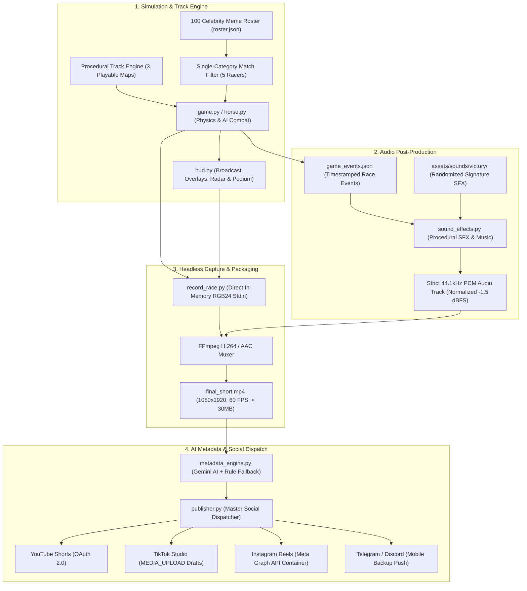

# 🏇 HORSE HAVOC — The Autonomous Celebrity Meme Racing Engine

<div align="center">

[](https://www.python.org/)
[](https://pyga.me/)
[](https://ffmpeg.org/)
[](https://www.youtube.com/@Hero.Hero7)
[](https://developers.tiktok.com/)
[](https://developers.facebook.com/)
[](#-security--zero-leak-protection)
[](LICENSE)

<br/>

**A broadcast-grade, 100% autonomous 2D top-down racing engine and social publishing pipeline.**  
Simulates procedural 5-racer derby matches featuring celebrity meme caricatures, synthesizes noise-free 44.1kHz audio, streams frames headlessly to FFmpeg, generates viral metadata with AI, and dispatches directly to **YouTube Shorts**, **TikTok**, and **Instagram Reels**.

<br/>

### 📺 [Official YouTube Channel: @HorseHavoc](https://www.youtube.com/@HorseHavoc)

</div>

---

## ⚡ What is Horse Havoc?

**Horse Havoc** is a fully automated, cloud-ready content generation factory. It generates procedural 1080x1920 (9:16 vertical) short-form videos tailored for the algorithmic retention curves of mobile feeds:

- **Strict 45-Second Pacing**: Sprint finish occurs at ~41.5 seconds, followed immediately by a dynamic photo finish and a 3.5-second celebratory victory podium with confetti.
- **100 Meme Personalities**: Featuring sports legends, content creators, tech titans, world leaders, and pop culture icons.
- **Single-Category Derby System**: Matches randomly select 5 contenders from the exact same group (e.g., all-Football or all-Streamer showdowns) with custom HUD branding and signature victory anthems.
- **Direct-to-Memory FFmpeg Pipeline**: Emits zero uncompressed disk frames, piping raw RGB24 bytes via standard input directly into single-pass H.264/AAC MP4 encoding.
- **Triple-Platform Social Dispatch**: Publishes simultaneously to YouTube Shorts (Data API v3), TikTok Mobile App Drafts (Content Posting API v2), and Instagram Reels (Meta Graph API v20.0).

---

## 🏗️ System Architecture



---

## 🌟 Key Features

### 1. 100 Celebrity Meme Roster across 5 Themed Categories
Celebrities are categorized in `assets/celebrities/roster.json` with enlarged bobblehead caricatures (~80-95px diameter) and crisp 3px solid white outline borders:
- **⚽ Football Legends**: Ronaldo, Messi, Mbappé, Neymar, Haaland, Bellingham, De Bruyne, Zidane, Maradona, etc.
- **🎮 Content Creators & Streamers**: MrBeast, IShowSpeed, Kai Cenat, PewDiePie, xQc, Ninja, Logan Paul, KSI, etc.
- **💻 Tech Titans & Billionaires**: Elon Musk, Mark Zuckerberg, Steve Jobs, Bill Gates, Jeff Bezos, Jensen Huang, Sam Altman, etc.
- **🌍 World Leaders & History**: Barack Obama, Donald Trump, Vladimir Putin, Abraham Lincoln, Winston Churchill, Julius Caesar, etc.
- **🌟 Pop Culture & Icons**: Walter White, Spider-Man, Goku, Naruto, Luffy, The Rock, Keanu Reeves, SpongeBob, etc.

### 2. 3 Procedural Playable Track Maps
- **Classic Turf Derby**: Lush grass rails, traditional dirt surface, mud puddle slow zones, and wooden hurdles.
- **Desert Dunes Canyon**: Sandstone canyon terrain, rock barriers, quicksand hazards, and golden turbo speed boost pads.
- **Cyber Neon Stadium**: Dark synthwave grid asphalt, cyan & magenta glowing boundary barriers, EMP glitch traps, and neon acceleration grids.

### 3. Noise-Free Broadcast Audio Canvas
- **0 dB Noise Floor**: Digital silence baseline between sounds (no annoying background hiss or static hum).
- **Normalized Headroom**: Peak ceiling locked at **-1.5 dBFS** (73% int16 amplitude) with soft-knee limiting.
- **Randomized Finish Anthems**: Every race finishes with a unique viral audio stinger (Cristiano Ronaldo *SIUUU*, MLG 3x Airhorns, Anime Dramatic Impact, Royal Fanfare, Retro 8-bit, or Whinny).

### 4. 24/7 Autonomous Linux Cloud Runner
- Fully compatible with headless Ubuntu servers (`SDL_VIDEODRIVER="dummy"`).
- Automated twice-daily scheduling (12:00 AM & 12:00 PM local time).
- Integrated 24-hour disk retention policy (`cleanup_manager.py`) automatically pruning expired `.mp4` video files to protect tight storage quotas.

---

## 🚀 Quick Start & Installation

### Prerequisites
- **Python 3.10+**
- **FFmpeg** installed and accessible in your system `PATH`
- Git

### 1. Clone & Set Up Virtual Environment

```bash
# Clone the repository
git clone https://github.com/your-username/horse-havoc.git
cd horse-havoc

# Create and activate virtual environment
python -m venv venv

# On Linux/macOS:
source venv/bin/activate

# On Windows (PowerShell):
.\venv\Scripts\Activate.ps1

# Install lightweight dependencies
pip install -r requirements.txt
```

### 2. Interactive Desktop Play (Controls & Testing)

Launch the interactive Pygame window on your desktop:

```bash
python main.py
```

| Key | Action |
| :---: | :--- |
| **`SPACE`** | Pause / Resume race simulation |
| **`R`** | Restart race with a fresh random seed and new category |
| **`D`** | Toggle AI obstacle feelers and collision hitboxes |
| **`F`** | Cycle simulation speed (`1x` $\rightarrow$ `2x` $\rightarrow$ `4x` fast-forward) |
| **`C`** | Trigger immediate headless MP4 video recording |
| **`ESC` / `Q`** | Quit application |

### 3. Headless MP4 Video Recording

Render a broadcast-ready 1080x1920 race video to MP4 headlessly:

```bash
# Full ~45-second match recording with clean synchronized audio
python record_race.py -o clean_race.mp4

# Fixed seed reproducibility
python record_race.py -o match_seed42.mp4 --seed 42

# Ultrafast preview render
python record_race.py -o test.mp4 --preset ultrafast
```

---

## 🤖 Automated Production & Social Media Dispatch

Horse Havoc can run completely unattended to generate and publish matches:

```bash
# Full automated run (simulation -> audio mux -> metadata -> triple publish)
python auto_run.py --public --all

# Publish to YouTube Shorts and TikTok (skip Instagram)
python auto_run.py --no-instagram

# Headless smoke test verification (no live upload)
python auto_run.py --test --no-dispatch
```

### Environment Configuration (`.env`)

Copy the template configuration file:
```bash
cp .env.example .env
```

Open `.env` and fill in your desired platform credentials:

```env
# Google Gemini API for Viral Metadata Generation (Free: https://aistudio.google.com/)
GEMINI_API_KEY=your_gemini_api_key_here

# YouTube Data API v3 (OAuth 2.0)
YOUTUBE_CLIENT_SECRETS_FILE=client_secrets.json
YOUTUBE_TOKEN_FILE=token.json
YOUTUBE_PRIVACY_STATUS=public

# TikTok Content Posting API v2
TIKTOK_CLIENT_KEY=your_tiktok_client_key
TIKTOK_CLIENT_SECRET=your_tiktok_client_secret
TIKTOK_POST_MODE=MEDIA_UPLOAD
TIKTOK_PRIVACY_LEVEL=PUBLIC_TO_EVERYONE

# Instagram Reels (Meta Graph API v20.0)
META_APP_ID=your_meta_app_id
META_APP_SECRET=your_meta_app_secret
INSTAGRAM_ACCOUNT_ID=your_instagram_account_id
INSTAGRAM_ACCESS_TOKEN=your_instagram_page_token

# Optional Mobile Notifications (Telegram / Discord)
TELEGRAM_BOT_TOKEN=
TELEGRAM_CHAT_ID=
DISCORD_WEBHOOK_URL=
```

---

## ☁️ Autonomous Linux VPS Deployment (One-Click)

The repository includes a turn-key deployment script for Ubuntu 22.04 / 24.04 LTS servers:

```bash
# Make deployment scripts executable
chmod +x setup_vps.sh setup_crontab.sh

# Run one-click setup engine
./setup_vps.sh
```

`setup_vps.sh` automatically:
1. Installs minimal system packages (`ffmpeg`, `python3-venv`, `xvfb`, fonts).
2. Creates an isolated virtualenv and installs non-compiled requirements.
3. Configures a twice-daily Crontab schedule (12:00 AM & 12:00 PM local time).
4. Installs an hourly cleanup cron job purging `.mp4` video files older than 24 hours.
5. Runs a headless verification smoke test under `dummy` video driver.

---

## 🔒 Security & Zero-Leak Protection

This repository is maintained with strict credential isolation:
- **Zero Hardcoded Secrets**: All access tokens, client secrets, API keys, and account IDs are read dynamically from environment variables or `.env`.
- **Pre-Commit Git Protection**: The repository `.gitignore` strictly blocks all credential files (`.env`, `token.json`, `tiktok_token.json`, `instagram_token.json`, `client_secrets.json`), temporary video recordings (`*.mp4`), build artifacts, and system logs.
- **Automated Expiration Handling**: `refresh_instagram_token.py` checks token health via Meta's `/debug_token` endpoint and exchanges near-expiration tokens automatically before publishing.

---

## 📄 License

This project is licensed under the [MIT License](LICENSE).

---

<div align="center">

**Horse Havoc Gaming Studio**  
*Autonomous AI Racing & Content Engine*  
[YouTube: @HorseHavoc](https://www.youtube.com/@HorseHavoc)

</div>
